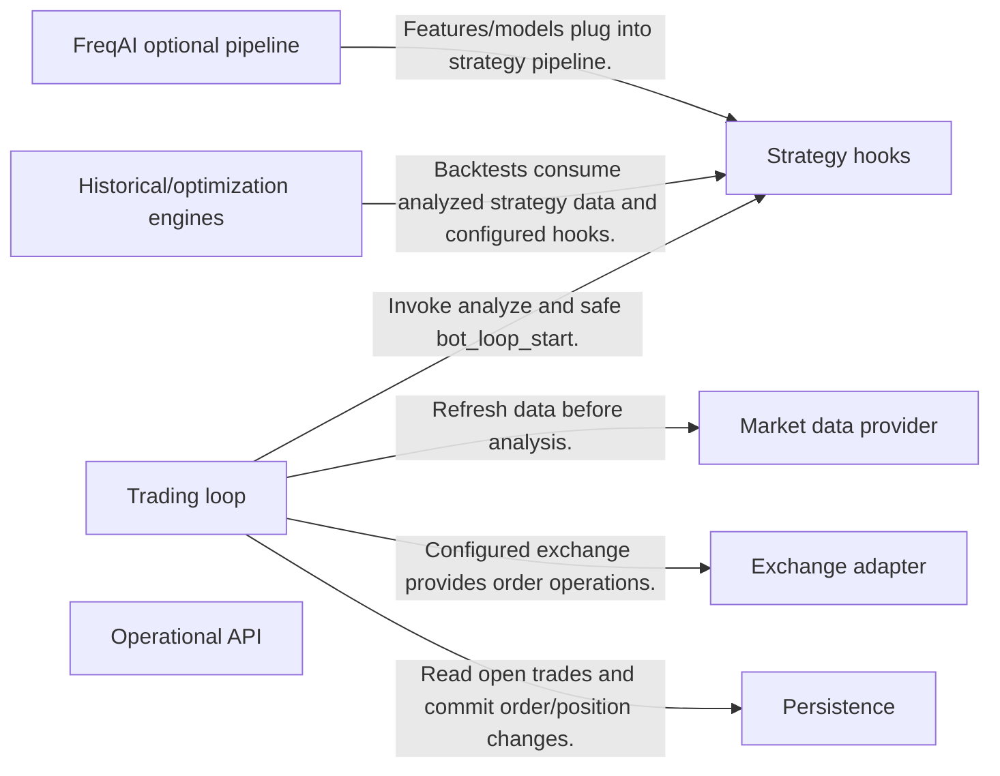
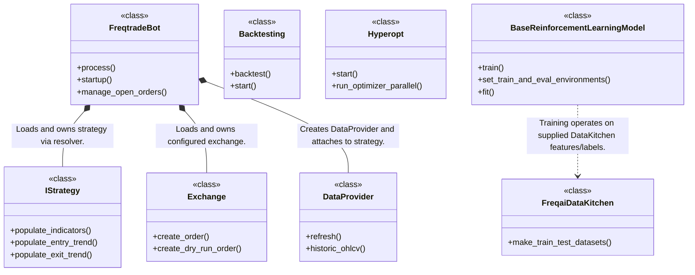
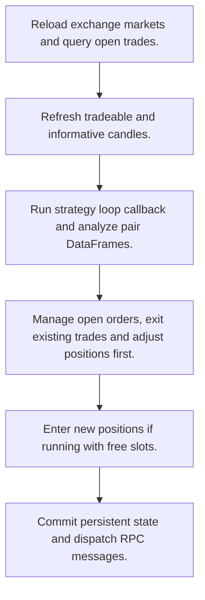
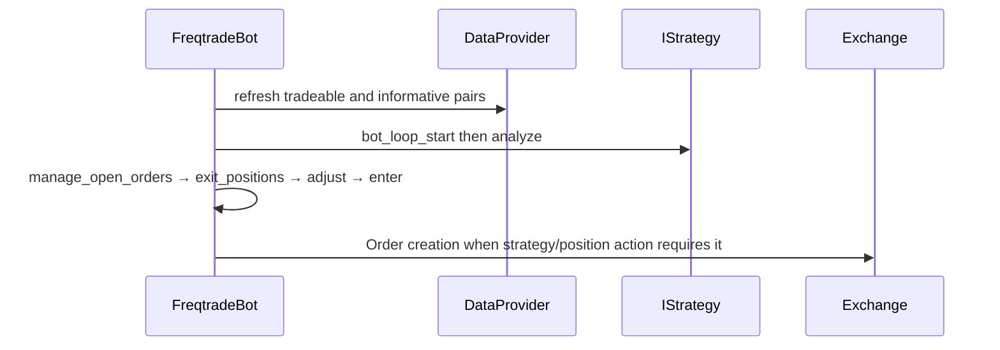

# freqtrade: workflow, design and architecture

Updated: **2026-10-13**
Reviewed Git hash: `323ee733de0a4807516c648261444df1bd5298de`
Branch: `feature/ayu_develop`
Source diff SHA256: `e3b0c44298fc1c149afbf4c8996fb92427ae41e4649b934ca495991b7852b855`
Scope: **Crypto trading / research engine** / Maintenance: **active**
Languages: Python

[HTML edition](ayu-develop.html) / [Development](development.md) / [Historical validation](validation.md) / [Full system comparison](../../docs/index.html)

## Purpose and scope

Run configured crypto strategies in live or dry-run sessions, candle-driven historical replay, parameter optimization and optional FreqAI model pipelines.

## Features and support boundaries

Native = implemented here. Integration = supplied through a named host/API. Limited = material restriction. Not provided = evidenced scope exclusion. Unverified = support/absence not established. Not applicable = outside this artifact type.

| Capability | Status | Implementation and limits | Source |
|---|---|---|---|
| Backtesting | Native | Local bot/replay/dry-run/strategy/protection/ledger/optimizer implementations supply these behaviors; broker access and optional dependencies require configured integrations. | [FreqtradeBot.__init__](../src/freqtrade/freqtradebot.py) ([L94](https://github.com/alexcwyu/freqtrade/blob/323ee733de0a4807516c648261444df1bd5298de/src/freqtrade/freqtradebot.py#L94)) / [FreqtradeBot.process](../src/freqtrade/freqtradebot.py) ([L306](https://github.com/alexcwyu/freqtrade/blob/323ee733de0a4807516c648261444df1bd5298de/src/freqtrade/freqtradebot.py#L306)) / [Exchange.create_order](../src/freqtrade/exchange/exchange.py) ([L1498](https://github.com/alexcwyu/freqtrade/blob/323ee733de0a4807516c648261444df1bd5298de/src/freqtrade/exchange/exchange.py#L1498)) / [Exchange.create_dry_run_order](../src/freqtrade/exchange/exchange.py) ([L1206](https://github.com/alexcwyu/freqtrade/blob/323ee733de0a4807516c648261444df1bd5298de/src/freqtrade/exchange/exchange.py#L1206)) / [Backtesting.backtest](../src/freqtrade/optimize/backtesting.py) ([L1763](https://github.com/alexcwyu/freqtrade/blob/323ee733de0a4807516c648261444df1bd5298de/src/freqtrade/optimize/backtesting.py#L1763)) / [Hyperopt.start](../src/freqtrade/optimize/hyperopt/hyperopt.py) ([L216](https://github.com/alexcwyu/freqtrade/blob/323ee733de0a4807516c648261444df1bd5298de/src/freqtrade/optimize/hyperopt/hyperopt.py#L216)) / [DataProvider.refresh](../src/freqtrade/data/dataprovider.py) ([L460](https://github.com/alexcwyu/freqtrade/blob/323ee733de0a4807516c648261444df1bd5298de/src/freqtrade/data/dataprovider.py#L460)) / [main](../src/freqtrade/main.py) ([L31](https://github.com/alexcwyu/freqtrade/blob/323ee733de0a4807516c648261444df1bd5298de/src/freqtrade/main.py#L31)) |
| Live execution | Native | Local bot/replay/dry-run/strategy/protection/ledger/optimizer implementations supply these behaviors; broker access and optional dependencies require configured integrations. | [FreqtradeBot.__init__](../src/freqtrade/freqtradebot.py) ([L94](https://github.com/alexcwyu/freqtrade/blob/323ee733de0a4807516c648261444df1bd5298de/src/freqtrade/freqtradebot.py#L94)) / [FreqtradeBot.process](../src/freqtrade/freqtradebot.py) ([L306](https://github.com/alexcwyu/freqtrade/blob/323ee733de0a4807516c648261444df1bd5298de/src/freqtrade/freqtradebot.py#L306)) / [Exchange.create_order](../src/freqtrade/exchange/exchange.py) ([L1498](https://github.com/alexcwyu/freqtrade/blob/323ee733de0a4807516c648261444df1bd5298de/src/freqtrade/exchange/exchange.py#L1498)) / [Exchange.create_dry_run_order](../src/freqtrade/exchange/exchange.py) ([L1206](https://github.com/alexcwyu/freqtrade/blob/323ee733de0a4807516c648261444df1bd5298de/src/freqtrade/exchange/exchange.py#L1206)) / [Backtesting.backtest](../src/freqtrade/optimize/backtesting.py) ([L1763](https://github.com/alexcwyu/freqtrade/blob/323ee733de0a4807516c648261444df1bd5298de/src/freqtrade/optimize/backtesting.py#L1763)) / [Hyperopt.start](../src/freqtrade/optimize/hyperopt/hyperopt.py) ([L216](https://github.com/alexcwyu/freqtrade/blob/323ee733de0a4807516c648261444df1bd5298de/src/freqtrade/optimize/hyperopt/hyperopt.py#L216)) / [DataProvider.refresh](../src/freqtrade/data/dataprovider.py) ([L460](https://github.com/alexcwyu/freqtrade/blob/323ee733de0a4807516c648261444df1bd5298de/src/freqtrade/data/dataprovider.py#L460)) / [main](../src/freqtrade/main.py) ([L31](https://github.com/alexcwyu/freqtrade/blob/323ee733de0a4807516c648261444df1bd5298de/src/freqtrade/main.py#L31)) |
| Paper trading | Native | Local bot/replay/dry-run/strategy/protection/ledger/optimizer implementations supply these behaviors; broker access and optional dependencies require configured integrations. | [FreqtradeBot.__init__](../src/freqtrade/freqtradebot.py) ([L94](https://github.com/alexcwyu/freqtrade/blob/323ee733de0a4807516c648261444df1bd5298de/src/freqtrade/freqtradebot.py#L94)) / [FreqtradeBot.process](../src/freqtrade/freqtradebot.py) ([L306](https://github.com/alexcwyu/freqtrade/blob/323ee733de0a4807516c648261444df1bd5298de/src/freqtrade/freqtradebot.py#L306)) / [Exchange.create_order](../src/freqtrade/exchange/exchange.py) ([L1498](https://github.com/alexcwyu/freqtrade/blob/323ee733de0a4807516c648261444df1bd5298de/src/freqtrade/exchange/exchange.py#L1498)) / [Exchange.create_dry_run_order](../src/freqtrade/exchange/exchange.py) ([L1206](https://github.com/alexcwyu/freqtrade/blob/323ee733de0a4807516c648261444df1bd5298de/src/freqtrade/exchange/exchange.py#L1206)) / [Backtesting.backtest](../src/freqtrade/optimize/backtesting.py) ([L1763](https://github.com/alexcwyu/freqtrade/blob/323ee733de0a4807516c648261444df1bd5298de/src/freqtrade/optimize/backtesting.py#L1763)) / [Hyperopt.start](../src/freqtrade/optimize/hyperopt/hyperopt.py) ([L216](https://github.com/alexcwyu/freqtrade/blob/323ee733de0a4807516c648261444df1bd5298de/src/freqtrade/optimize/hyperopt/hyperopt.py#L216)) / [DataProvider.refresh](../src/freqtrade/data/dataprovider.py) ([L460](https://github.com/alexcwyu/freqtrade/blob/323ee733de0a4807516c648261444df1bd5298de/src/freqtrade/data/dataprovider.py#L460)) / [main](../src/freqtrade/main.py) ([L31](https://github.com/alexcwyu/freqtrade/blob/323ee733de0a4807516c648261444df1bd5298de/src/freqtrade/main.py#L31)) |
| Event driven | Limited | Stateful candle/timestamp processing and callbacks are present; main bot is a refreshed/throttled processing loop rather than a general tick-level event engine. | [FreqtradeBot.process](../src/freqtrade/freqtradebot.py) ([L306](https://github.com/alexcwyu/freqtrade/blob/323ee733de0a4807516c648261444df1bd5298de/src/freqtrade/freqtradebot.py#L306)) / [Backtesting.backtest](../src/freqtrade/optimize/backtesting.py) ([L1763](https://github.com/alexcwyu/freqtrade/blob/323ee733de0a4807516c648261444df1bd5298de/src/freqtrade/optimize/backtesting.py#L1763)) |
| Vectorized | Limited | Strategy DataFrame indicator/signal hooks are vectorized; backtest fills iterate chronological candle/pair data. | [IStrategy.populate_entry_trend](../src/freqtrade/strategy/interface.py) ([L254](https://github.com/alexcwyu/freqtrade/blob/323ee733de0a4807516c648261444df1bd5298de/src/freqtrade/strategy/interface.py#L254)) / [Backtesting.backtest](../src/freqtrade/optimize/backtesting.py) ([L1763](https://github.com/alexcwyu/freqtrade/blob/323ee733de0a4807516c648261444df1bd5298de/src/freqtrade/optimize/backtesting.py#L1763)) |
| Order management | Native | Local bot/replay/dry-run/strategy/protection/ledger/optimizer implementations supply these behaviors; broker access and optional dependencies require configured integrations. | [FreqtradeBot.__init__](../src/freqtrade/freqtradebot.py) ([L94](https://github.com/alexcwyu/freqtrade/blob/323ee733de0a4807516c648261444df1bd5298de/src/freqtrade/freqtradebot.py#L94)) / [FreqtradeBot.process](../src/freqtrade/freqtradebot.py) ([L306](https://github.com/alexcwyu/freqtrade/blob/323ee733de0a4807516c648261444df1bd5298de/src/freqtrade/freqtradebot.py#L306)) / [Exchange.create_order](../src/freqtrade/exchange/exchange.py) ([L1498](https://github.com/alexcwyu/freqtrade/blob/323ee733de0a4807516c648261444df1bd5298de/src/freqtrade/exchange/exchange.py#L1498)) / [Exchange.create_dry_run_order](../src/freqtrade/exchange/exchange.py) ([L1206](https://github.com/alexcwyu/freqtrade/blob/323ee733de0a4807516c648261444df1bd5298de/src/freqtrade/exchange/exchange.py#L1206)) / [Backtesting.backtest](../src/freqtrade/optimize/backtesting.py) ([L1763](https://github.com/alexcwyu/freqtrade/blob/323ee733de0a4807516c648261444df1bd5298de/src/freqtrade/optimize/backtesting.py#L1763)) / [Hyperopt.start](../src/freqtrade/optimize/hyperopt/hyperopt.py) ([L216](https://github.com/alexcwyu/freqtrade/blob/323ee733de0a4807516c648261444df1bd5298de/src/freqtrade/optimize/hyperopt/hyperopt.py#L216)) / [DataProvider.refresh](../src/freqtrade/data/dataprovider.py) ([L460](https://github.com/alexcwyu/freqtrade/blob/323ee733de0a4807516c648261444df1bd5298de/src/freqtrade/data/dataprovider.py#L460)) / [main](../src/freqtrade/main.py) ([L31](https://github.com/alexcwyu/freqtrade/blob/323ee733de0a4807516c648261444df1bd5298de/src/freqtrade/main.py#L31)) |
| Order types | Native | Local bot/replay/dry-run/strategy/protection/ledger/optimizer implementations supply these behaviors; broker access and optional dependencies require configured integrations. | [FreqtradeBot.__init__](../src/freqtrade/freqtradebot.py) ([L94](https://github.com/alexcwyu/freqtrade/blob/323ee733de0a4807516c648261444df1bd5298de/src/freqtrade/freqtradebot.py#L94)) / [FreqtradeBot.process](../src/freqtrade/freqtradebot.py) ([L306](https://github.com/alexcwyu/freqtrade/blob/323ee733de0a4807516c648261444df1bd5298de/src/freqtrade/freqtradebot.py#L306)) / [Exchange.create_order](../src/freqtrade/exchange/exchange.py) ([L1498](https://github.com/alexcwyu/freqtrade/blob/323ee733de0a4807516c648261444df1bd5298de/src/freqtrade/exchange/exchange.py#L1498)) / [Exchange.create_dry_run_order](../src/freqtrade/exchange/exchange.py) ([L1206](https://github.com/alexcwyu/freqtrade/blob/323ee733de0a4807516c648261444df1bd5298de/src/freqtrade/exchange/exchange.py#L1206)) / [Backtesting.backtest](../src/freqtrade/optimize/backtesting.py) ([L1763](https://github.com/alexcwyu/freqtrade/blob/323ee733de0a4807516c648261444df1bd5298de/src/freqtrade/optimize/backtesting.py#L1763)) / [Hyperopt.start](../src/freqtrade/optimize/hyperopt/hyperopt.py) ([L216](https://github.com/alexcwyu/freqtrade/blob/323ee733de0a4807516c648261444df1bd5298de/src/freqtrade/optimize/hyperopt/hyperopt.py#L216)) / [DataProvider.refresh](../src/freqtrade/data/dataprovider.py) ([L460](https://github.com/alexcwyu/freqtrade/blob/323ee733de0a4807516c648261444df1bd5298de/src/freqtrade/data/dataprovider.py#L460)) / [main](../src/freqtrade/main.py) ([L31](https://github.com/alexcwyu/freqtrade/blob/323ee733de0a4807516c648261444df1bd5298de/src/freqtrade/main.py#L31)) |
| Multi venue | Limited | Exchange resolver offers different venues, but each FreqtradeBot owns one configured Exchange. Multi-bot setup is separate from one multi-venue portfolio session. | [FreqtradeBot.__init__](../src/freqtrade/freqtradebot.py) ([L94](https://github.com/alexcwyu/freqtrade/blob/323ee733de0a4807516c648261444df1bd5298de/src/freqtrade/freqtradebot.py#L94)) |
| Crypto | Integration | CCXT exchange routing and bot futures funding/liquidation paths combine with venue support/market contracts. | [FreqtradeBot.__init__](../src/freqtrade/freqtradebot.py) ([L94](https://github.com/alexcwyu/freqtrade/blob/323ee733de0a4807516c648261444df1bd5298de/src/freqtrade/freqtradebot.py#L94)) / [Exchange.create_order](../src/freqtrade/exchange/exchange.py) ([L1498](https://github.com/alexcwyu/freqtrade/blob/323ee733de0a4807516c648261444df1bd5298de/src/freqtrade/exchange/exchange.py#L1498)) |
| Equities | Unverified | Representative source review did not establish this capability; no claim of absence. | Not applicable to this repository scope. |
| Futures | Integration | CCXT exchange routing and bot futures funding/liquidation paths combine with venue support/market contracts. | [FreqtradeBot.__init__](../src/freqtrade/freqtradebot.py) ([L94](https://github.com/alexcwyu/freqtrade/blob/323ee733de0a4807516c648261444df1bd5298de/src/freqtrade/freqtradebot.py#L94)) / [Exchange.create_order](../src/freqtrade/exchange/exchange.py) ([L1498](https://github.com/alexcwyu/freqtrade/blob/323ee733de0a4807516c648261444df1bd5298de/src/freqtrade/exchange/exchange.py#L1498)) |
| Options | Unverified | Representative source review did not establish this capability; no claim of absence. | Not applicable to this repository scope. |
| Forex | Unverified | Representative source review did not establish this capability; no claim of absence. | Not applicable to this repository scope. |
| Strategy api | Native | Local bot/replay/dry-run/strategy/protection/ledger/optimizer implementations supply these behaviors; broker access and optional dependencies require configured integrations. | [FreqtradeBot.__init__](../src/freqtrade/freqtradebot.py) ([L94](https://github.com/alexcwyu/freqtrade/blob/323ee733de0a4807516c648261444df1bd5298de/src/freqtrade/freqtradebot.py#L94)) / [FreqtradeBot.process](../src/freqtrade/freqtradebot.py) ([L306](https://github.com/alexcwyu/freqtrade/blob/323ee733de0a4807516c648261444df1bd5298de/src/freqtrade/freqtradebot.py#L306)) / [Exchange.create_order](../src/freqtrade/exchange/exchange.py) ([L1498](https://github.com/alexcwyu/freqtrade/blob/323ee733de0a4807516c648261444df1bd5298de/src/freqtrade/exchange/exchange.py#L1498)) / [Exchange.create_dry_run_order](../src/freqtrade/exchange/exchange.py) ([L1206](https://github.com/alexcwyu/freqtrade/blob/323ee733de0a4807516c648261444df1bd5298de/src/freqtrade/exchange/exchange.py#L1206)) / [Backtesting.backtest](../src/freqtrade/optimize/backtesting.py) ([L1763](https://github.com/alexcwyu/freqtrade/blob/323ee733de0a4807516c648261444df1bd5298de/src/freqtrade/optimize/backtesting.py#L1763)) / [Hyperopt.start](../src/freqtrade/optimize/hyperopt/hyperopt.py) ([L216](https://github.com/alexcwyu/freqtrade/blob/323ee733de0a4807516c648261444df1bd5298de/src/freqtrade/optimize/hyperopt/hyperopt.py#L216)) / [DataProvider.refresh](../src/freqtrade/data/dataprovider.py) ([L460](https://github.com/alexcwyu/freqtrade/blob/323ee733de0a4807516c648261444df1bd5298de/src/freqtrade/data/dataprovider.py#L460)) / [main](../src/freqtrade/main.py) ([L31](https://github.com/alexcwyu/freqtrade/blob/323ee733de0a4807516c648261444df1bd5298de/src/freqtrade/main.py#L31)) |
| Optimization | Native | Local bot/replay/dry-run/strategy/protection/ledger/optimizer implementations supply these behaviors; broker access and optional dependencies require configured integrations. | [FreqtradeBot.__init__](../src/freqtrade/freqtradebot.py) ([L94](https://github.com/alexcwyu/freqtrade/blob/323ee733de0a4807516c648261444df1bd5298de/src/freqtrade/freqtradebot.py#L94)) / [FreqtradeBot.process](../src/freqtrade/freqtradebot.py) ([L306](https://github.com/alexcwyu/freqtrade/blob/323ee733de0a4807516c648261444df1bd5298de/src/freqtrade/freqtradebot.py#L306)) / [Exchange.create_order](../src/freqtrade/exchange/exchange.py) ([L1498](https://github.com/alexcwyu/freqtrade/blob/323ee733de0a4807516c648261444df1bd5298de/src/freqtrade/exchange/exchange.py#L1498)) / [Exchange.create_dry_run_order](../src/freqtrade/exchange/exchange.py) ([L1206](https://github.com/alexcwyu/freqtrade/blob/323ee733de0a4807516c648261444df1bd5298de/src/freqtrade/exchange/exchange.py#L1206)) / [Backtesting.backtest](../src/freqtrade/optimize/backtesting.py) ([L1763](https://github.com/alexcwyu/freqtrade/blob/323ee733de0a4807516c648261444df1bd5298de/src/freqtrade/optimize/backtesting.py#L1763)) / [Hyperopt.start](../src/freqtrade/optimize/hyperopt/hyperopt.py) ([L216](https://github.com/alexcwyu/freqtrade/blob/323ee733de0a4807516c648261444df1bd5298de/src/freqtrade/optimize/hyperopt/hyperopt.py#L216)) / [DataProvider.refresh](../src/freqtrade/data/dataprovider.py) ([L460](https://github.com/alexcwyu/freqtrade/blob/323ee733de0a4807516c648261444df1bd5298de/src/freqtrade/data/dataprovider.py#L460)) / [main](../src/freqtrade/main.py) ([L31](https://github.com/alexcwyu/freqtrade/blob/323ee733de0a4807516c648261444df1bd5298de/src/freqtrade/main.py#L31)) |
| Machine learning | Integration | Native FreqAI orchestration integrates optional model libraries and RL environment/Maskable evaluation dependencies. | [FreqaiDataKitchen.make_train_test_datasets](../src/freqtrade/freqai/data_kitchen.py) ([L124](https://github.com/alexcwyu/freqtrade/blob/323ee733de0a4807516c648261444df1bd5298de/src/freqtrade/freqai/data_kitchen.py#L124)) / [BaseReinforcementLearningModel.train](../src/freqtrade/freqai/RL/BaseReinforcementLearningModel.py) ([L99](https://github.com/alexcwyu/freqtrade/blob/323ee733de0a4807516c648261444df1bd5298de/src/freqtrade/freqai/RL/BaseReinforcementLearningModel.py#L99)) / [BaseReinforcementLearningModel.set_train_and_eval_environments](../src/freqtrade/freqai/RL/BaseReinforcementLearningModel.py) ([L153](https://github.com/alexcwyu/freqtrade/blob/323ee733de0a4807516c648261444df1bd5298de/src/freqtrade/freqai/RL/BaseReinforcementLearningModel.py#L153)) |
| Reinforcement learning | Integration | Native FreqAI orchestration integrates optional model libraries and RL environment/Maskable evaluation dependencies. | [FreqaiDataKitchen.make_train_test_datasets](../src/freqtrade/freqai/data_kitchen.py) ([L124](https://github.com/alexcwyu/freqtrade/blob/323ee733de0a4807516c648261444df1bd5298de/src/freqtrade/freqai/data_kitchen.py#L124)) / [BaseReinforcementLearningModel.train](../src/freqtrade/freqai/RL/BaseReinforcementLearningModel.py) ([L99](https://github.com/alexcwyu/freqtrade/blob/323ee733de0a4807516c648261444df1bd5298de/src/freqtrade/freqai/RL/BaseReinforcementLearningModel.py#L99)) / [BaseReinforcementLearningModel.set_train_and_eval_environments](../src/freqtrade/freqai/RL/BaseReinforcementLearningModel.py) ([L153](https://github.com/alexcwyu/freqtrade/blob/323ee733de0a4807516c648261444df1bd5298de/src/freqtrade/freqai/RL/BaseReinforcementLearningModel.py#L153)) |
| Portfolio | Native | Local bot/replay/dry-run/strategy/protection/ledger/optimizer implementations supply these behaviors; broker access and optional dependencies require configured integrations. | [FreqtradeBot.__init__](../src/freqtrade/freqtradebot.py) ([L94](https://github.com/alexcwyu/freqtrade/blob/323ee733de0a4807516c648261444df1bd5298de/src/freqtrade/freqtradebot.py#L94)) / [FreqtradeBot.process](../src/freqtrade/freqtradebot.py) ([L306](https://github.com/alexcwyu/freqtrade/blob/323ee733de0a4807516c648261444df1bd5298de/src/freqtrade/freqtradebot.py#L306)) / [Exchange.create_order](../src/freqtrade/exchange/exchange.py) ([L1498](https://github.com/alexcwyu/freqtrade/blob/323ee733de0a4807516c648261444df1bd5298de/src/freqtrade/exchange/exchange.py#L1498)) / [Exchange.create_dry_run_order](../src/freqtrade/exchange/exchange.py) ([L1206](https://github.com/alexcwyu/freqtrade/blob/323ee733de0a4807516c648261444df1bd5298de/src/freqtrade/exchange/exchange.py#L1206)) / [Backtesting.backtest](../src/freqtrade/optimize/backtesting.py) ([L1763](https://github.com/alexcwyu/freqtrade/blob/323ee733de0a4807516c648261444df1bd5298de/src/freqtrade/optimize/backtesting.py#L1763)) / [Hyperopt.start](../src/freqtrade/optimize/hyperopt/hyperopt.py) ([L216](https://github.com/alexcwyu/freqtrade/blob/323ee733de0a4807516c648261444df1bd5298de/src/freqtrade/optimize/hyperopt/hyperopt.py#L216)) / [DataProvider.refresh](../src/freqtrade/data/dataprovider.py) ([L460](https://github.com/alexcwyu/freqtrade/blob/323ee733de0a4807516c648261444df1bd5298de/src/freqtrade/data/dataprovider.py#L460)) / [main](../src/freqtrade/main.py) ([L31](https://github.com/alexcwyu/freqtrade/blob/323ee733de0a4807516c648261444df1bd5298de/src/freqtrade/main.py#L31)) |
| Risk management | Native | Local bot/replay/dry-run/strategy/protection/ledger/optimizer implementations supply these behaviors; broker access and optional dependencies require configured integrations. | [FreqtradeBot.__init__](../src/freqtrade/freqtradebot.py) ([L94](https://github.com/alexcwyu/freqtrade/blob/323ee733de0a4807516c648261444df1bd5298de/src/freqtrade/freqtradebot.py#L94)) / [FreqtradeBot.process](../src/freqtrade/freqtradebot.py) ([L306](https://github.com/alexcwyu/freqtrade/blob/323ee733de0a4807516c648261444df1bd5298de/src/freqtrade/freqtradebot.py#L306)) / [Exchange.create_order](../src/freqtrade/exchange/exchange.py) ([L1498](https://github.com/alexcwyu/freqtrade/blob/323ee733de0a4807516c648261444df1bd5298de/src/freqtrade/exchange/exchange.py#L1498)) / [Exchange.create_dry_run_order](../src/freqtrade/exchange/exchange.py) ([L1206](https://github.com/alexcwyu/freqtrade/blob/323ee733de0a4807516c648261444df1bd5298de/src/freqtrade/exchange/exchange.py#L1206)) / [Backtesting.backtest](../src/freqtrade/optimize/backtesting.py) ([L1763](https://github.com/alexcwyu/freqtrade/blob/323ee733de0a4807516c648261444df1bd5298de/src/freqtrade/optimize/backtesting.py#L1763)) / [Hyperopt.start](../src/freqtrade/optimize/hyperopt/hyperopt.py) ([L216](https://github.com/alexcwyu/freqtrade/blob/323ee733de0a4807516c648261444df1bd5298de/src/freqtrade/optimize/hyperopt/hyperopt.py#L216)) / [DataProvider.refresh](../src/freqtrade/data/dataprovider.py) ([L460](https://github.com/alexcwyu/freqtrade/blob/323ee733de0a4807516c648261444df1bd5298de/src/freqtrade/data/dataprovider.py#L460)) / [main](../src/freqtrade/main.py) ([L31](https://github.com/alexcwyu/freqtrade/blob/323ee733de0a4807516c648261444df1bd5298de/src/freqtrade/main.py#L31)) |
| Performance analytics | Native | Local backtesting report pipeline computes trade/profit statistics, Sharpe/Sortino/Calmar and drawdown; FreqUI displays these backend-computed values through API integration. | [calculate_sharpe](../src/freqtrade/data/metrics.py) ([L455](https://github.com/alexcwyu/freqtrade/blob/323ee733de0a4807516c648261444df1bd5298de/src/freqtrade/data/metrics.py#L455)) / [generate_strategy_stats](../src/freqtrade/optimize/optimize_reports/optimize_reports.py) ([L554](https://github.com/alexcwyu/freqtrade/blob/323ee733de0a4807516c648261444df1bd5298de/src/freqtrade/optimize/optimize_reports/optimize_reports.py#L554)) / [Backtesting.start](../src/freqtrade/optimize/backtesting.py) ([L1906](https://github.com/alexcwyu/freqtrade/blob/323ee733de0a4807516c648261444df1bd5298de/src/freqtrade/optimize/backtesting.py#L1906)) |
| Historical data | Native | Local bot/replay/dry-run/strategy/protection/ledger/optimizer implementations supply these behaviors; broker access and optional dependencies require configured integrations. | [FreqtradeBot.__init__](../src/freqtrade/freqtradebot.py) ([L94](https://github.com/alexcwyu/freqtrade/blob/323ee733de0a4807516c648261444df1bd5298de/src/freqtrade/freqtradebot.py#L94)) / [FreqtradeBot.process](../src/freqtrade/freqtradebot.py) ([L306](https://github.com/alexcwyu/freqtrade/blob/323ee733de0a4807516c648261444df1bd5298de/src/freqtrade/freqtradebot.py#L306)) / [Exchange.create_order](../src/freqtrade/exchange/exchange.py) ([L1498](https://github.com/alexcwyu/freqtrade/blob/323ee733de0a4807516c648261444df1bd5298de/src/freqtrade/exchange/exchange.py#L1498)) / [Exchange.create_dry_run_order](../src/freqtrade/exchange/exchange.py) ([L1206](https://github.com/alexcwyu/freqtrade/blob/323ee733de0a4807516c648261444df1bd5298de/src/freqtrade/exchange/exchange.py#L1206)) / [Backtesting.backtest](../src/freqtrade/optimize/backtesting.py) ([L1763](https://github.com/alexcwyu/freqtrade/blob/323ee733de0a4807516c648261444df1bd5298de/src/freqtrade/optimize/backtesting.py#L1763)) / [Hyperopt.start](../src/freqtrade/optimize/hyperopt/hyperopt.py) ([L216](https://github.com/alexcwyu/freqtrade/blob/323ee733de0a4807516c648261444df1bd5298de/src/freqtrade/optimize/hyperopt/hyperopt.py#L216)) / [DataProvider.refresh](../src/freqtrade/data/dataprovider.py) ([L460](https://github.com/alexcwyu/freqtrade/blob/323ee733de0a4807516c648261444df1bd5298de/src/freqtrade/data/dataprovider.py#L460)) / [main](../src/freqtrade/main.py) ([L31](https://github.com/alexcwyu/freqtrade/blob/323ee733de0a4807516c648261444df1bd5298de/src/freqtrade/main.py#L31)) |
| Streaming data | Limited | Exchange refresh may use optional venue websocket support; inspected primary flow refreshes OHLCV/trades each loop. | [DataProvider.refresh](../src/freqtrade/data/dataprovider.py) ([L460](https://github.com/alexcwyu/freqtrade/blob/323ee733de0a4807516c648261444df1bd5298de/src/freqtrade/data/dataprovider.py#L460)) / [FreqtradeBot.process](../src/freqtrade/freqtradebot.py) ([L306](https://github.com/alexcwyu/freqtrade/blob/323ee733de0a4807516c648261444df1bd5298de/src/freqtrade/freqtradebot.py#L306)) |
| Persistence | Native | Local bot/replay/dry-run/strategy/protection/ledger/optimizer implementations supply these behaviors; broker access and optional dependencies require configured integrations. | [FreqtradeBot.__init__](../src/freqtrade/freqtradebot.py) ([L94](https://github.com/alexcwyu/freqtrade/blob/323ee733de0a4807516c648261444df1bd5298de/src/freqtrade/freqtradebot.py#L94)) / [FreqtradeBot.process](../src/freqtrade/freqtradebot.py) ([L306](https://github.com/alexcwyu/freqtrade/blob/323ee733de0a4807516c648261444df1bd5298de/src/freqtrade/freqtradebot.py#L306)) / [Exchange.create_order](../src/freqtrade/exchange/exchange.py) ([L1498](https://github.com/alexcwyu/freqtrade/blob/323ee733de0a4807516c648261444df1bd5298de/src/freqtrade/exchange/exchange.py#L1498)) / [Exchange.create_dry_run_order](../src/freqtrade/exchange/exchange.py) ([L1206](https://github.com/alexcwyu/freqtrade/blob/323ee733de0a4807516c648261444df1bd5298de/src/freqtrade/exchange/exchange.py#L1206)) / [Backtesting.backtest](../src/freqtrade/optimize/backtesting.py) ([L1763](https://github.com/alexcwyu/freqtrade/blob/323ee733de0a4807516c648261444df1bd5298de/src/freqtrade/optimize/backtesting.py#L1763)) / [Hyperopt.start](../src/freqtrade/optimize/hyperopt/hyperopt.py) ([L216](https://github.com/alexcwyu/freqtrade/blob/323ee733de0a4807516c648261444df1bd5298de/src/freqtrade/optimize/hyperopt/hyperopt.py#L216)) / [DataProvider.refresh](../src/freqtrade/data/dataprovider.py) ([L460](https://github.com/alexcwyu/freqtrade/blob/323ee733de0a4807516c648261444df1bd5298de/src/freqtrade/data/dataprovider.py#L460)) / [main](../src/freqtrade/main.py) ([L31](https://github.com/alexcwyu/freqtrade/blob/323ee733de0a4807516c648261444df1bd5298de/src/freqtrade/main.py#L31)) |
| Data pipeline | Native | Local bot/replay/dry-run/strategy/protection/ledger/optimizer implementations supply these behaviors; broker access and optional dependencies require configured integrations. | [FreqtradeBot.__init__](../src/freqtrade/freqtradebot.py) ([L94](https://github.com/alexcwyu/freqtrade/blob/323ee733de0a4807516c648261444df1bd5298de/src/freqtrade/freqtradebot.py#L94)) / [FreqtradeBot.process](../src/freqtrade/freqtradebot.py) ([L306](https://github.com/alexcwyu/freqtrade/blob/323ee733de0a4807516c648261444df1bd5298de/src/freqtrade/freqtradebot.py#L306)) / [Exchange.create_order](../src/freqtrade/exchange/exchange.py) ([L1498](https://github.com/alexcwyu/freqtrade/blob/323ee733de0a4807516c648261444df1bd5298de/src/freqtrade/exchange/exchange.py#L1498)) / [Exchange.create_dry_run_order](../src/freqtrade/exchange/exchange.py) ([L1206](https://github.com/alexcwyu/freqtrade/blob/323ee733de0a4807516c648261444df1bd5298de/src/freqtrade/exchange/exchange.py#L1206)) / [Backtesting.backtest](../src/freqtrade/optimize/backtesting.py) ([L1763](https://github.com/alexcwyu/freqtrade/blob/323ee733de0a4807516c648261444df1bd5298de/src/freqtrade/optimize/backtesting.py#L1763)) / [Hyperopt.start](../src/freqtrade/optimize/hyperopt/hyperopt.py) ([L216](https://github.com/alexcwyu/freqtrade/blob/323ee733de0a4807516c648261444df1bd5298de/src/freqtrade/optimize/hyperopt/hyperopt.py#L216)) / [DataProvider.refresh](../src/freqtrade/data/dataprovider.py) ([L460](https://github.com/alexcwyu/freqtrade/blob/323ee733de0a4807516c648261444df1bd5298de/src/freqtrade/data/dataprovider.py#L460)) / [main](../src/freqtrade/main.py) ([L31](https://github.com/alexcwyu/freqtrade/blob/323ee733de0a4807516c648261444df1bd5298de/src/freqtrade/main.py#L31)) |
| Web ui | Integration | REST/RPC backend exposes control/reporting and frontend integration; independent FreqUI supplies interactive client. | [ApiServer.start_api](../src/freqtrade/rpc/api_server/webserver.py) ([L295](https://github.com/alexcwyu/freqtrade/blob/323ee733de0a4807516c648261444df1bd5298de/src/freqtrade/rpc/api_server/webserver.py#L295)) / [FreqtradeBot.process](../src/freqtrade/freqtradebot.py) ([L306](https://github.com/alexcwyu/freqtrade/blob/323ee733de0a4807516c648261444df1bd5298de/src/freqtrade/freqtradebot.py#L306)) / [Backtesting.backtest](../src/freqtrade/optimize/backtesting.py) ([L1763](https://github.com/alexcwyu/freqtrade/blob/323ee733de0a4807516c648261444df1bd5298de/src/freqtrade/optimize/backtesting.py#L1763)) |
| Cli | Native | Local bot/replay/dry-run/strategy/protection/ledger/optimizer implementations supply these behaviors; broker access and optional dependencies require configured integrations. | [FreqtradeBot.__init__](../src/freqtrade/freqtradebot.py) ([L94](https://github.com/alexcwyu/freqtrade/blob/323ee733de0a4807516c648261444df1bd5298de/src/freqtrade/freqtradebot.py#L94)) / [FreqtradeBot.process](../src/freqtrade/freqtradebot.py) ([L306](https://github.com/alexcwyu/freqtrade/blob/323ee733de0a4807516c648261444df1bd5298de/src/freqtrade/freqtradebot.py#L306)) / [Exchange.create_order](../src/freqtrade/exchange/exchange.py) ([L1498](https://github.com/alexcwyu/freqtrade/blob/323ee733de0a4807516c648261444df1bd5298de/src/freqtrade/exchange/exchange.py#L1498)) / [Exchange.create_dry_run_order](../src/freqtrade/exchange/exchange.py) ([L1206](https://github.com/alexcwyu/freqtrade/blob/323ee733de0a4807516c648261444df1bd5298de/src/freqtrade/exchange/exchange.py#L1206)) / [Backtesting.backtest](../src/freqtrade/optimize/backtesting.py) ([L1763](https://github.com/alexcwyu/freqtrade/blob/323ee733de0a4807516c648261444df1bd5298de/src/freqtrade/optimize/backtesting.py#L1763)) / [Hyperopt.start](../src/freqtrade/optimize/hyperopt/hyperopt.py) ([L216](https://github.com/alexcwyu/freqtrade/blob/323ee733de0a4807516c648261444df1bd5298de/src/freqtrade/optimize/hyperopt/hyperopt.py#L216)) / [DataProvider.refresh](../src/freqtrade/data/dataprovider.py) ([L460](https://github.com/alexcwyu/freqtrade/blob/323ee733de0a4807516c648261444df1bd5298de/src/freqtrade/data/dataprovider.py#L460)) / [main](../src/freqtrade/main.py) ([L31](https://github.com/alexcwyu/freqtrade/blob/323ee733de0a4807516c648261444df1bd5298de/src/freqtrade/main.py#L31)) |
| Monitoring | Integration | REST/RPC backend exposes control/reporting and frontend integration; independent FreqUI supplies interactive client. | [ApiServer.start_api](../src/freqtrade/rpc/api_server/webserver.py) ([L295](https://github.com/alexcwyu/freqtrade/blob/323ee733de0a4807516c648261444df1bd5298de/src/freqtrade/rpc/api_server/webserver.py#L295)) / [FreqtradeBot.process](../src/freqtrade/freqtradebot.py) ([L306](https://github.com/alexcwyu/freqtrade/blob/323ee733de0a4807516c648261444df1bd5298de/src/freqtrade/freqtradebot.py#L306)) / [Backtesting.backtest](../src/freqtrade/optimize/backtesting.py) ([L1763](https://github.com/alexcwyu/freqtrade/blob/323ee733de0a4807516c648261444df1bd5298de/src/freqtrade/optimize/backtesting.py#L1763)) |
| Extension api | Native | Local bot/replay/dry-run/strategy/protection/ledger/optimizer implementations supply these behaviors; broker access and optional dependencies require configured integrations. | [FreqtradeBot.__init__](../src/freqtrade/freqtradebot.py) ([L94](https://github.com/alexcwyu/freqtrade/blob/323ee733de0a4807516c648261444df1bd5298de/src/freqtrade/freqtradebot.py#L94)) / [FreqtradeBot.process](../src/freqtrade/freqtradebot.py) ([L306](https://github.com/alexcwyu/freqtrade/blob/323ee733de0a4807516c648261444df1bd5298de/src/freqtrade/freqtradebot.py#L306)) / [Exchange.create_order](../src/freqtrade/exchange/exchange.py) ([L1498](https://github.com/alexcwyu/freqtrade/blob/323ee733de0a4807516c648261444df1bd5298de/src/freqtrade/exchange/exchange.py#L1498)) / [Exchange.create_dry_run_order](../src/freqtrade/exchange/exchange.py) ([L1206](https://github.com/alexcwyu/freqtrade/blob/323ee733de0a4807516c648261444df1bd5298de/src/freqtrade/exchange/exchange.py#L1206)) / [Backtesting.backtest](../src/freqtrade/optimize/backtesting.py) ([L1763](https://github.com/alexcwyu/freqtrade/blob/323ee733de0a4807516c648261444df1bd5298de/src/freqtrade/optimize/backtesting.py#L1763)) / [Hyperopt.start](../src/freqtrade/optimize/hyperopt/hyperopt.py) ([L216](https://github.com/alexcwyu/freqtrade/blob/323ee733de0a4807516c648261444df1bd5298de/src/freqtrade/optimize/hyperopt/hyperopt.py#L216)) / [DataProvider.refresh](../src/freqtrade/data/dataprovider.py) ([L460](https://github.com/alexcwyu/freqtrade/blob/323ee733de0a4807516c648261444df1bd5298de/src/freqtrade/data/dataprovider.py#L460)) / [main](../src/freqtrade/main.py) ([L31](https://github.com/alexcwyu/freqtrade/blob/323ee733de0a4807516c648261444df1bd5298de/src/freqtrade/main.py#L31)) |
| Native acceleration | Unverified | Representative source review did not establish this capability; no claim of absence. | Not applicable to this repository scope. |
| Distributed execution | Limited | Hyperopt uses local joblib process parallelism; that is not evidence of distributed live portfolio execution. | [Hyperopt.start](../src/freqtrade/optimize/hyperopt/hyperopt.py) ([L216](https://github.com/alexcwyu/freqtrade/blob/323ee733de0a4807516c648261444df1bd5298de/src/freqtrade/optimize/hyperopt/hyperopt.py#L216)) |

## System components

| Component | Responsibility | Source |
|---|---|---|
| Trading loop | Analyze candles and manage orders/exits/entries. | [FreqtradeBot.__init__](../src/freqtrade/freqtradebot.py) ([L94](https://github.com/alexcwyu/freqtrade/blob/323ee733de0a4807516c648261444df1bd5298de/src/freqtrade/freqtradebot.py#L94)) / [FreqtradeBot.process](../src/freqtrade/freqtradebot.py) ([L306](https://github.com/alexcwyu/freqtrade/blob/323ee733de0a4807516c648261444df1bd5298de/src/freqtrade/freqtradebot.py#L306)) |
| Strategy hooks | DataFrame signals plus custom entry/exit/risk lifecycle hooks. | [IStrategy.populate_entry_trend](../src/freqtrade/strategy/interface.py) ([L254](https://github.com/alexcwyu/freqtrade/blob/323ee733de0a4807516c648261444df1bd5298de/src/freqtrade/strategy/interface.py#L254)) |
| Exchange adapter | CCXT order routing and local dry-run fill model. | [Exchange.create_order](../src/freqtrade/exchange/exchange.py) ([L1498](https://github.com/alexcwyu/freqtrade/blob/323ee733de0a4807516c648261444df1bd5298de/src/freqtrade/exchange/exchange.py#L1498)) / [Exchange.create_dry_run_order](../src/freqtrade/exchange/exchange.py) ([L1206](https://github.com/alexcwyu/freqtrade/blob/323ee733de0a4807516c648261444df1bd5298de/src/freqtrade/exchange/exchange.py#L1206)) |
| Market data provider | Refresh/cache tradeable and informative pair histories. | [DataProvider.refresh](../src/freqtrade/data/dataprovider.py) ([L460](https://github.com/alexcwyu/freqtrade/blob/323ee733de0a4807516c648261444df1bd5298de/src/freqtrade/data/dataprovider.py#L460)) |
| Historical/optimization engines | Chronological replay and parallel parameter trials. | [Backtesting.backtest](../src/freqtrade/optimize/backtesting.py) ([L1763](https://github.com/alexcwyu/freqtrade/blob/323ee733de0a4807516c648261444df1bd5298de/src/freqtrade/optimize/backtesting.py#L1763)) / [Hyperopt.start](../src/freqtrade/optimize/hyperopt/hyperopt.py) ([L216](https://github.com/alexcwyu/freqtrade/blob/323ee733de0a4807516c648261444df1bd5298de/src/freqtrade/optimize/hyperopt/hyperopt.py#L216)) |
| FreqAI optional pipeline | Train/test transformations and model/RL environment interfaces. | [FreqaiDataKitchen.make_train_test_datasets](../src/freqtrade/freqai/data_kitchen.py) ([L124](https://github.com/alexcwyu/freqtrade/blob/323ee733de0a4807516c648261444df1bd5298de/src/freqtrade/freqai/data_kitchen.py#L124)) / [BaseReinforcementLearningModel.train](../src/freqtrade/freqai/RL/BaseReinforcementLearningModel.py) ([L99](https://github.com/alexcwyu/freqtrade/blob/323ee733de0a4807516c648261444df1bd5298de/src/freqtrade/freqai/RL/BaseReinforcementLearningModel.py#L99)) |
| Persistence | Persistent trades and order state reconciliation. | [Order.update_from_ccxt_object](../src/freqtrade/persistence/trade_model.py) ([L197](https://github.com/alexcwyu/freqtrade/blob/323ee733de0a4807516c648261444df1bd5298de/src/freqtrade/persistence/trade_model.py#L197)) |
| Operational API | REST control/reporting and frontend integration. | [ApiServer.start_api](../src/freqtrade/rpc/api_server/webserver.py) ([L295](https://github.com/alexcwyu/freqtrade/blob/323ee733de0a4807516c648261444df1bd5298de/src/freqtrade/rpc/api_server/webserver.py#L295)) |

## Architecture and component boundaries

The component view summarizes inspected responsibility boundaries. Arrows identify the documented API/data dependencies; this is not a deployment-readiness claim.

- Refresh data before analysis.: [FreqtradeBot.process](../src/freqtrade/freqtradebot.py) ([L306](https://github.com/alexcwyu/freqtrade/blob/323ee733de0a4807516c648261444df1bd5298de/src/freqtrade/freqtradebot.py#L306))
- Invoke analyze and safe bot_loop_start.: [FreqtradeBot.process](../src/freqtrade/freqtradebot.py) ([L306](https://github.com/alexcwyu/freqtrade/blob/323ee733de0a4807516c648261444df1bd5298de/src/freqtrade/freqtradebot.py#L306))
- Configured exchange provides order operations.: [FreqtradeBot.__init__](../src/freqtrade/freqtradebot.py) ([L94](https://github.com/alexcwyu/freqtrade/blob/323ee733de0a4807516c648261444df1bd5298de/src/freqtrade/freqtradebot.py#L94)) / [Exchange.create_order](../src/freqtrade/exchange/exchange.py) ([L1498](https://github.com/alexcwyu/freqtrade/blob/323ee733de0a4807516c648261444df1bd5298de/src/freqtrade/exchange/exchange.py#L1498))
- Read open trades and commit order/position changes.: [FreqtradeBot.process](../src/freqtrade/freqtradebot.py) ([L306](https://github.com/alexcwyu/freqtrade/blob/323ee733de0a4807516c648261444df1bd5298de/src/freqtrade/freqtradebot.py#L306))
- Backtests consume analyzed strategy data and configured hooks.: [Backtesting.backtest](../src/freqtrade/optimize/backtesting.py) ([L1763](https://github.com/alexcwyu/freqtrade/blob/323ee733de0a4807516c648261444df1bd5298de/src/freqtrade/optimize/backtesting.py#L1763))
- Features/models plug into strategy pipeline.: [FreqaiDataKitchen.make_train_test_datasets](../src/freqtrade/freqai/data_kitchen.py) ([L124](https://github.com/alexcwyu/freqtrade/blob/323ee733de0a4807516c648261444df1bd5298de/src/freqtrade/freqai/data_kitchen.py#L124)) / [BaseReinforcementLearningModel.train](../src/freqtrade/freqai/RL/BaseReinforcementLearningModel.py) ([L99](https://github.com/alexcwyu/freqtrade/blob/323ee733de0a4807516c648261444df1bd5298de/src/freqtrade/freqai/RL/BaseReinforcementLearningModel.py#L99))

## Design decisions

| Decision | Rationale | Tradeoff | Evidence |
|---|---|---|---|
| Exit/reconcile existing trades before new entries. | Preserves trade slots and avoids order/force-exit races using exit lock. | Order/analysis latency is tied to serial loop processing and configured refresh cadence. | [FreqtradeBot.process](../src/freqtrade/freqtradebot.py) ([L306](https://github.com/alexcwyu/freqtrade/blob/323ee733de0a4807516c648261444df1bd5298de/src/freqtrade/freqtradebot.py#L306)) |
| Separate vectorized signal preparation from chronological trade simulation. | DataFrame hooks compute indicators efficiently while order/portfolio path remains stateful. | Vectorized indicators do not establish a fully vectorized fill/portfolio engine. | [IStrategy.populate_entry_trend](../src/freqtrade/strategy/interface.py) ([L254](https://github.com/alexcwyu/freqtrade/blob/323ee733de0a4807516c648261444df1bd5298de/src/freqtrade/strategy/interface.py#L254)) / [Backtesting.backtest](../src/freqtrade/optimize/backtesting.py) ([L1763](https://github.com/alexcwyu/freqtrade/blob/323ee733de0a4807516c648261444df1bd5298de/src/freqtrade/optimize/backtesting.py#L1763)) |

## Class and interface relationships

Each node is a reviewed source symbol. Function/module nodes are explicitly labeled; they do not imply Python classes. Only reviewed relationships are drawn.

- **FreqtradeBot** (class): [FreqtradeBot.process](../src/freqtrade/freqtradebot.py) ([L306](https://github.com/alexcwyu/freqtrade/blob/323ee733de0a4807516c648261444df1bd5298de/src/freqtrade/freqtradebot.py#L306))
- **IStrategy** (class): [IStrategy.populate_entry_trend](../src/freqtrade/strategy/interface.py) ([L254](https://github.com/alexcwyu/freqtrade/blob/323ee733de0a4807516c648261444df1bd5298de/src/freqtrade/strategy/interface.py#L254))
- **Exchange** (class): [Exchange.create_order](../src/freqtrade/exchange/exchange.py) ([L1498](https://github.com/alexcwyu/freqtrade/blob/323ee733de0a4807516c648261444df1bd5298de/src/freqtrade/exchange/exchange.py#L1498))
- **DataProvider** (class): [DataProvider.refresh](../src/freqtrade/data/dataprovider.py) ([L460](https://github.com/alexcwyu/freqtrade/blob/323ee733de0a4807516c648261444df1bd5298de/src/freqtrade/data/dataprovider.py#L460))
- **Backtesting** (class): [Backtesting.backtest](../src/freqtrade/optimize/backtesting.py) ([L1763](https://github.com/alexcwyu/freqtrade/blob/323ee733de0a4807516c648261444df1bd5298de/src/freqtrade/optimize/backtesting.py#L1763))
- **Hyperopt** (class): [Hyperopt.start](../src/freqtrade/optimize/hyperopt/hyperopt.py) ([L216](https://github.com/alexcwyu/freqtrade/blob/323ee733de0a4807516c648261444df1bd5298de/src/freqtrade/optimize/hyperopt/hyperopt.py#L216))
- **FreqaiDataKitchen** (class): [FreqaiDataKitchen.make_train_test_datasets](../src/freqtrade/freqai/data_kitchen.py) ([L124](https://github.com/alexcwyu/freqtrade/blob/323ee733de0a4807516c648261444df1bd5298de/src/freqtrade/freqai/data_kitchen.py#L124))
- **BaseReinforcementLearningModel** (class): [BaseReinforcementLearningModel.train](../src/freqtrade/freqai/RL/BaseReinforcementLearningModel.py) ([L99](https://github.com/alexcwyu/freqtrade/blob/323ee733de0a4807516c648261444df1bd5298de/src/freqtrade/freqai/RL/BaseReinforcementLearningModel.py#L99))

## Workflow

### Live/dry-run processing cycle

Live/dry-run routing is controlled by Exchange.create_order; none of these network operations were executed during this audit.

1. Reload exchange markets and query open trades.. [FreqtradeBot.process](../src/freqtrade/freqtradebot.py) ([L306](https://github.com/alexcwyu/freqtrade/blob/323ee733de0a4807516c648261444df1bd5298de/src/freqtrade/freqtradebot.py#L306))
2. Refresh tradeable and informative candles.. [DataProvider.refresh](../src/freqtrade/data/dataprovider.py) ([L460](https://github.com/alexcwyu/freqtrade/blob/323ee733de0a4807516c648261444df1bd5298de/src/freqtrade/data/dataprovider.py#L460)) / [FreqtradeBot.process](../src/freqtrade/freqtradebot.py) ([L306](https://github.com/alexcwyu/freqtrade/blob/323ee733de0a4807516c648261444df1bd5298de/src/freqtrade/freqtradebot.py#L306))
3. Run strategy loop callback and analyze pair DataFrames.. [FreqtradeBot.process](../src/freqtrade/freqtradebot.py) ([L306](https://github.com/alexcwyu/freqtrade/blob/323ee733de0a4807516c648261444df1bd5298de/src/freqtrade/freqtradebot.py#L306))
4. Manage open orders; exit existing trades and adjust positions first.. [FreqtradeBot.process](../src/freqtrade/freqtradebot.py) ([L306](https://github.com/alexcwyu/freqtrade/blob/323ee733de0a4807516c648261444df1bd5298de/src/freqtrade/freqtradebot.py#L306))
5. Enter new positions if running with free slots.. [FreqtradeBot.process](../src/freqtrade/freqtradebot.py) ([L306](https://github.com/alexcwyu/freqtrade/blob/323ee733de0a4807516c648261444df1bd5298de/src/freqtrade/freqtradebot.py#L306))
6. Commit persistent state and dispatch RPC messages.. [FreqtradeBot.process](../src/freqtrade/freqtradebot.py) ([L306](https://github.com/alexcwyu/freqtrade/blob/323ee733de0a4807516c648261444df1bd5298de/src/freqtrade/freqtradebot.py#L306))

## Sequence

One strategy cycle

Order call is conditional downstream processing, not guaranteed on every cycle.

- refresh tradeable and informative pairs: [FreqtradeBot.process](../src/freqtrade/freqtradebot.py) ([L306](https://github.com/alexcwyu/freqtrade/blob/323ee733de0a4807516c648261444df1bd5298de/src/freqtrade/freqtradebot.py#L306))
- bot_loop_start then analyze: [FreqtradeBot.process](../src/freqtrade/freqtradebot.py) ([L306](https://github.com/alexcwyu/freqtrade/blob/323ee733de0a4807516c648261444df1bd5298de/src/freqtrade/freqtradebot.py#L306))
- manage_open_orders → exit_positions → adjust → enter: [FreqtradeBot.process](../src/freqtrade/freqtradebot.py) ([L306](https://github.com/alexcwyu/freqtrade/blob/323ee733de0a4807516c648261444df1bd5298de/src/freqtrade/freqtradebot.py#L306))
- Order creation when strategy/position action requires it: [FreqtradeBot.process](../src/freqtrade/freqtradebot.py) ([L306](https://github.com/alexcwyu/freqtrade/blob/323ee733de0a4807516c648261444df1bd5298de/src/freqtrade/freqtradebot.py#L306)) / [Exchange.create_order](../src/freqtrade/exchange/exchange.py) ([L1498](https://github.com/alexcwyu/freqtrade/blob/323ee733de0a4807516c648261444df1bd5298de/src/freqtrade/exchange/exchange.py#L1498))

## Strengths and limits

### Strengths

- The live/dry-run loop preserves shared strategy hooks and reconciliation order, while historical trials reuse the chronological backtesting engine. [FreqtradeBot.process](../src/freqtrade/freqtradebot.py) ([L306](https://github.com/alexcwyu/freqtrade/blob/323ee733de0a4807516c648261444df1bd5298de/src/freqtrade/freqtradebot.py#L306)) / [Exchange.create_dry_run_order](../src/freqtrade/exchange/exchange.py) ([L1206](https://github.com/alexcwyu/freqtrade/blob/323ee733de0a4807516c648261444df1bd5298de/src/freqtrade/exchange/exchange.py#L1206)) / [Backtesting.backtest](../src/freqtrade/optimize/backtesting.py) ([L1763](https://github.com/alexcwyu/freqtrade/blob/323ee733de0a4807516c648261444df1bd5298de/src/freqtrade/optimize/backtesting.py#L1763)) / [Hyperopt.start](../src/freqtrade/optimize/hyperopt/hyperopt.py) ([L216](https://github.com/alexcwyu/freqtrade/blob/323ee733de0a4807516c648261444df1bd5298de/src/freqtrade/optimize/hyperopt/hyperopt.py#L216))

### Limitations

- Each bot instance owns one exchange; multi-venue selection should not be described as simultaneous cross-venue execution within that instance. [FreqtradeBot.__init__](../src/freqtrade/freqtradebot.py) ([L94](https://github.com/alexcwyu/freqtrade/blob/323ee733de0a4807516c648261444df1bd5298de/src/freqtrade/freqtradebot.py#L94))

## Validation scope

The linked validation and command records preserve actual historical runs and user-authorized exclusions. This source/document review does not rerun application tests, establish live trading readiness or rank benchmark performance. Current data, credential and runtime prerequisites remain material.

[Repository validation](validation.md) / [Executed checks](maintenance/index.md)

## Source map

| Reviewed symbol/path | Inspected responsibility | Actual file SHA256 |
|---|---|---|
| [FreqtradeBot.__init__](../src/freqtrade/freqtradebot.py) ([L94](https://github.com/alexcwyu/freqtrade/blob/323ee733de0a4807516c648261444df1bd5298de/src/freqtrade/freqtradebot.py#L94)) | Loads exchange/strategy, initializes trade DB, wallets/RPC/DataProvider/pairlist, attaches dp and wallets to strategy, initializes protections. | `e9638343654d3c7d78548bb840830147fbb646ff4f5833312dcb45a7f70023f1` |
| [FreqtradeBot.process](../src/freqtrade/freqtradebot.py) ([L306](https://github.com/alexcwyu/freqtrade/blob/323ee733de0a4807516c648261444df1bd5298de/src/freqtrade/freqtradebot.py#L306)) | Reloads markets, refreshes candles, invokes strategy analysis, manages open orders, exits/adjusts positions before new entries, commits and dispatches RPC queue. | `e9638343654d3c7d78548bb840830147fbb646ff4f5833312dcb45a7f70023f1` |
| [IStrategy.populate_entry_trend](../src/freqtrade/strategy/interface.py) ([L254](https://github.com/alexcwyu/freqtrade/blob/323ee733de0a4807516c648261444df1bd5298de/src/freqtrade/strategy/interface.py#L254)) | User-overridden DataFrame entry signal hook; indicator/exit hooks and custom risk/order callbacks share the interface. | `5d0faa6da85bd223bcea2281bd173c7ffc54c3a9647ae136e4ebc7d5685dea02` |
| [Exchange.create_order](../src/freqtrade/exchange/exchange.py) ([L1498](https://github.com/alexcwyu/freqtrade/blob/323ee733de0a4807516c648261444df1bd5298de/src/freqtrade/exchange/exchange.py#L1498)) | Dry-run branch creates simulated orders; real branch rounds quantities/prices, prepares leverage, calls CCXT and maps errors. | `d37a2ed3eeb1b27ea20d154188f3098489e2f578a8143b54894d9929543dfbfb` |
| [Exchange.create_dry_run_order](../src/freqtrade/exchange/exchange.py) ([L1206](https://github.com/alexcwyu/freqtrade/blob/323ee733de0a4807516c648261444df1bd5298de/src/freqtrade/exchange/exchange.py#L1206)) | Synthesizes open order, uses order-book crossing/slippage and fee model, checks limit fill and tracks locally. | `d37a2ed3eeb1b27ea20d154188f3098489e2f578a8143b54894d9929543dfbfb` |
| [DataProvider.refresh](../src/freqtrade/data/dataprovider.py) ([L460](https://github.com/alexcwyu/freqtrade/blob/323ee733de0a4807516c648261444df1bd5298de/src/freqtrade/data/dataprovider.py#L460)) | Refreshes configured/informative pair OHLCV then optional public trades via exchange. | `3222d862fea2ca9dd566063b83845f99c421ba4f5eb20773ba5e64be68b0ba0e` |
| [Backtesting.backtest](../src/freqtrade/optimize/backtesting.py) ([L1763](https://github.com/alexcwyu/freqtrade/blob/323ee733de0a4807516c648261444df1bd5298de/src/freqtrade/optimize/backtesting.py#L1763)) | Resets state/wallets, converts analyzed OHLCV to lists, iterates chronological pair/candle generator, applies trade loop and finalizes results. | `1b185dfe44e5b0cbab0f2e35fae8c6f545c9aa987d556cd019bea1bd8880bfd1` |
| [Hyperopt.start](../src/freqtrade/optimize/hyperopt/hyperopt.py) ([L216](https://github.com/alexcwyu/freqtrade/blob/323ee733de0a4807516c648261444df1bd5298de/src/freqtrade/optimize/hyperopt/hyperopt.py#L216)) | Uses optimizer ask/tell, joblib Parallel batches of trial backtests, progress reporting and optional early stopping. | `e8ce6c542b1bf8d2ce072854d0d25ef05a8338144f77ecaf33e998dde88cd5d5` |
| [FreqaiDataKitchen.make_train_test_datasets](../src/freqtrade/freqai/data_kitchen.py) ([L124](https://github.com/alexcwyu/freqtrade/blob/323ee733de0a4807516c648261444df1bd5298de/src/freqtrade/freqai/data_kitchen.py#L124)) | Partitions features/labels into train/test datasets with configured split/weighting. | `00a0d1089dab1a8ae47ef5282ca6aa1c1fbb71cb95dc27193fee61c1d1bce82e` |
| [BaseReinforcementLearningModel.train](../src/freqtrade/freqai/RL/BaseReinforcementLearningModel.py) ([L99](https://github.com/alexcwyu/freqtrade/blob/323ee733de0a4807516c648261444df1bd5298de/src/freqtrade/freqai/RL/BaseReinforcementLearningModel.py#L99)) | Filters/transforms features, creates RL environments and invokes user/model fit. | `7f39d53cd7299066afccfe0a36c9cd91f0dd531a1cb1249e1ee18beeeae3ee36` |
| [BaseReinforcementLearningModel.set_train_and_eval_environments](../src/freqtrade/freqai/RL/BaseReinforcementLearningModel.py) ([L153](https://github.com/alexcwyu/freqtrade/blob/323ee733de0a4807516c648261444df1bd5298de/src/freqtrade/freqai/RL/BaseReinforcementLearningModel.py#L153)) | Creates MyRLEnv train/evaluation environments and MaskableEvalCallback for optional RL stack. | `7f39d53cd7299066afccfe0a36c9cd91f0dd531a1cb1249e1ee18beeeae3ee36` |
| [Order.update_from_ccxt_object](../src/freqtrade/persistence/trade_model.py) ([L197](https://github.com/alexcwyu/freqtrade/blob/323ee733de0a4807516c648261444df1bd5298de/src/freqtrade/persistence/trade_model.py#L197)) | Reconciles exchange order status/price/filled values into persistent order model. | `4cff97840736a4239eebdf6b1d0208e9667edf52348b93884583a9e02bc00c2f` |
| [ApiServer.start_api](../src/freqtrade/rpc/api_server/webserver.py) ([L295](https://github.com/alexcwyu/freqtrade/blob/323ee733de0a4807516c648261444df1bd5298de/src/freqtrade/rpc/api_server/webserver.py#L295)) | Starts configured REST API server; API setup registers auth/routers and optional UI. | `f445a4ad560f0e022f341096f67456c81196d21a0f51b5deffbe84fb48167bf2` |
| [main](../src/freqtrade/main.py) ([L31](https://github.com/alexcwyu/freqtrade/blob/323ee733de0a4807516c648261444df1bd5298de/src/freqtrade/main.py#L31)) | Parses subcommands, sets process/runtime configuration, dispatches registered command function. | `29f4debd9e9405aa232dedbcbf4eec02a642d16665dc361c8e9a67c13540e962` |
| [calculate_sharpe](../src/freqtrade/data/metrics.py) ([L455](https://github.com/alexcwyu/freqtrade/blob/323ee733de0a4807516c648261444df1bd5298de/src/freqtrade/data/metrics.py#L455)) | Computes local annualized Sharpe from trade profit_abs, starting balance and backtest date period; handles empty/invalid period. | `d5dfd23bcf556efc5faf23f6031d2b758f29feba0c2ace44080140da3de877ae` |
| [generate_strategy_stats](../src/freqtrade/optimize/optimize_reports/optimize_reports.py) ([L554](https://github.com/alexcwyu/freqtrade/blob/323ee733de0a4807516c648261444df1bd5298de/src/freqtrade/optimize/optimize_reports/optimize_reports.py#L554)) | Builds local per-strategy performance statistics including native Sharpe/Sortino/Calmar and maximum/relative drawdown from simulated trade results. | `6ae98213facc41065248aa1415328bba37237ba2627f391bde7d84eb699febf6` |
| [Backtesting.start](../src/freqtrade/optimize/backtesting.py) ([L1906](https://github.com/alexcwyu/freqtrade/blob/323ee733de0a4807516c648261444df1bd5298de/src/freqtrade/optimize/backtesting.py#L1906)) | Backtesting.start calls generate_backtest_stats at line 1932 after strategy runs to build local report from all strategy results. | `1b185dfe44e5b0cbab0f2e35fae8c6f545c9aa987d556cd019bea1bd8880bfd1` |

## Documentation provenance

Review date: 2026-10-13. Full committed source HEAD: `323ee733de0a4807516c648261444df1bd5298de`. Template version: 2. 13 source files were independently hashed for this guide.

[Evidence catalog](../../docs/systems-2026-10-13/catalog.json) / [Standard template](../../docs/guidelines/APP_TEMPLATE.md)

- Read-only source audit of inventory HEAD 323ee733de0a4807516c648261444df1bd5298de; no runtime execution, credential check or live-production assertion. Existing validation records remain separate historical evidence.
- Inspected implementation/configuration coverage: src/freqtrade/freqtradebot.py, src/freqtrade/strategy/interface.py, src/freqtrade/exchange/exchange.py, src/freqtrade/data/dataprovider.py, src/freqtrade/optimize/backtesting.py, src/freqtrade/optimize/hyperopt/hyperopt.py, src/freqtrade/freqai/data_kitchen.py, src/freqtrade/freqai/RL/BaseReinforcementLearningModel.py, src/freqtrade/persistence/trade_model.py, src/freqtrade/rpc/api_server/webserver.py, src/freqtrade/main.py
- Source symbols and call chains are representative coverage, not exhaustive connector, strategy or product certification. Integration statuses identify dependencies that supply the runtime behavior.
- Independent review correction: inspected data/metrics.py calculate_sharpe, optimize_reports.generate_strategy_stats and Backtesting.start local report generation. Performance analytics is native; separate FreqUI presentation does not make metrics implementation external.
