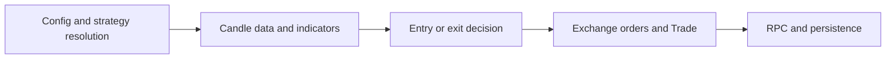
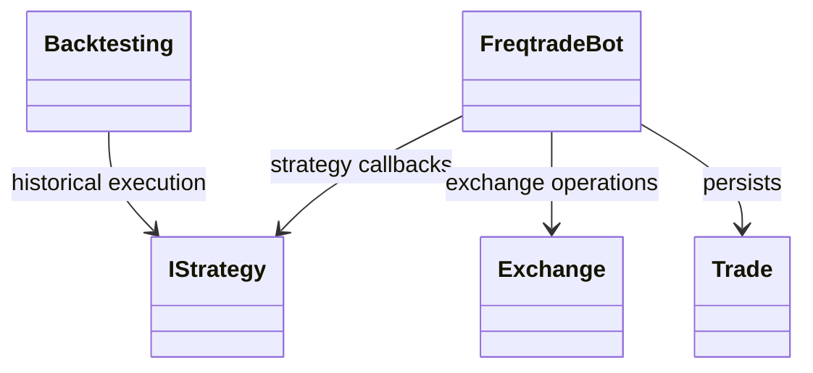
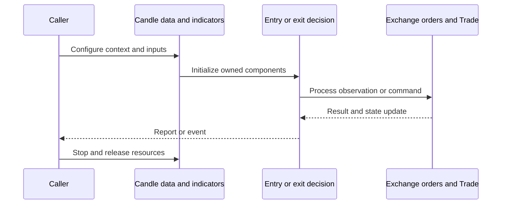
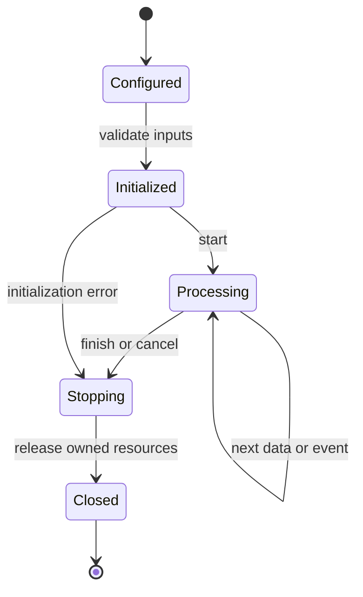
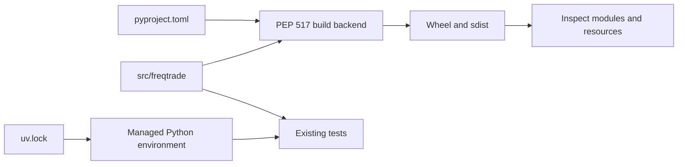
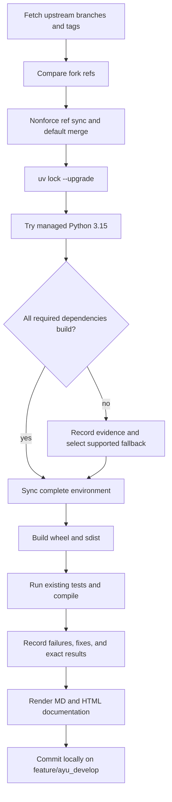

# freqtrade: architecture and development

Freqtrade runs automated crypto strategies with market-data management, backtesting/hyperoptimization, persistence, a REST API, Telegram control, and optional FreqAI prediction models.

## Components and boundaries

FreqtradeBot coordinates one processing cycle and owns Exchange, DataProvider, wallets, strategy, RPC, and persistence interactions. IStrategy supplies indicators and entry/exit decisions. Exchange wraps CCXT and synchronous/asynchronous market access. Trade/Order persist execution state. Backtesting reuses strategy interfaces with historical data; FreqAI prediction models add a separate data/training pipeline.

The following class view names implementation classes. Cross-package types are supplied by the host ecosystem; arrows describe inheritance or usage, not copied ownership.

## Runtime workflow

Resolve configuration and strategy, initialize exchange/markets and persistence, refresh candles, populate indicators and decisions, validate stake/risk constraints, submit orders, reconcile fills/stop orders, and notify RPC clients. Backtesting repeats decisions over historical timestamps and exports performance statistics. Command-owned exchange sessions are closed deterministically even after errors.

This sequence is an architectural view of responsibility and resource ownership. Individual plugin, connector, and strategy implementations can add asynchronous events and error branches. The lifecycle below is a conceptual operating workflow, rather than a claim that every component has one shared state enum.

## Features and extension points

Spot/futures strategies; order/stop-loss lifecycle; pair lists and protections; historical download/conversion; hyperoptimization and lookahead analysis; FastAPI/Telegram RPC; FreqAI and reinforcement-learning extras.

Extend the owning component behind its existing public interface. Keep metadata and configuration alongside plugin/strategy resources. Exchange-specific behavior belongs in an adapter; strategy decisions belong in the strategy/evaluator layer; persistence schema and migrations belong with the storage implementation. Review the source map below before changing a boundary, and exercise the existing tests associated with that boundary.

## Packaging and dependency design

The src layout retains all upstream namespace files and package resources. Latest runtime/development/optional requirements are reconciled with upstream, including TA-Lib and HTTP test-client changes. Python 3.15 all-extras is blocked by Torch wheel availability; managed Python 3.14.8 is selected. Test resource cleanup is explicit; warning filters and assertions are retained.

The lock records exact package versions, hashes, platform markers, and local source mappings. Path sources deliberately bind related repositories in this workspace; clone sibling repositories at the documented names before synchronization. Published packaging metadata describes public dependencies, while uv source settings select this development workspace. Resolve dependency changes with uv lock --upgrade and retain the generated lock, then verify the same locked environment.

## Maintenance workflow

All upstream branches and tags are fetched. Fork updates use nonforce pushes; a divergent branch is merged without erasing fork history. The default branch is merged into feature/ayu_develop with package/resource conflicts reconciled in their installed locations. Build and test evidence is recorded before a local maintenance commit. Feature branch publication is a separate root-level action.

No existing test assertions are removed and no new test cases are introduced in this maintenance pass. Corrected fixtures preserve coverage while making paths, corruption inputs, and resource cleanup compatible with the selected interpreter. A failed test or unsupported dependency is reported explicitly in [validation](validation.md); package build success does not imply strategy correctness, profitability, or successful live connectivity.

## Source map

| Source | Responsibility and location |
| --- | --- |
| [freqtradebot.py](../src/freqtrade/freqtradebot.py) | src/freqtrade/freqtradebot.py |
| [interface.py](../src/freqtrade/strategy/interface.py) | src/freqtrade/strategy/interface.py |
| [exchange.py](../src/freqtrade/exchange/exchange.py) | src/freqtrade/exchange/exchange.py |
| [trade_model.py](../src/freqtrade/persistence/trade_model.py) | src/freqtrade/persistence/trade_model.py |
| [dataprovider.py](../src/freqtrade/data/dataprovider.py) | src/freqtrade/data/dataprovider.py |
| [history_utils.py](../src/freqtrade/data/history/history_utils.py) | src/freqtrade/data/history/history_utils.py |
| [backtesting.py](../src/freqtrade/optimize/backtesting.py) | src/freqtrade/optimize/backtesting.py |
| [strategy_resolver.py](../src/freqtrade/resolvers/strategy_resolver.py) | src/freqtrade/resolvers/strategy_resolver.py |
| [webserver.py](../src/freqtrade/rpc/api_server/webserver.py) | src/freqtrade/rpc/api_server/webserver.py |
| [freqai_interface.py](../src/freqtrade/freqai/freqai_interface.py) | src/freqtrade/freqai/freqai_interface.py |
| [pyproject.toml](../pyproject.toml) | pyproject.toml |
| [uv.lock](../uv.lock) | uv.lock |
| [README.md](../README.md) | README.md |
| [conftest.py](../tests/conftest.py) | tests/conftest.py |

## Further reading

Use [development.md](development.md) for reproducible commands and [validation.md](validation.md) for exact interpreter, dependency, build, test, and blocker evidence. The equivalent [HTML architecture document](ayu-develop.html) supports browsing and rendered diagrams.
